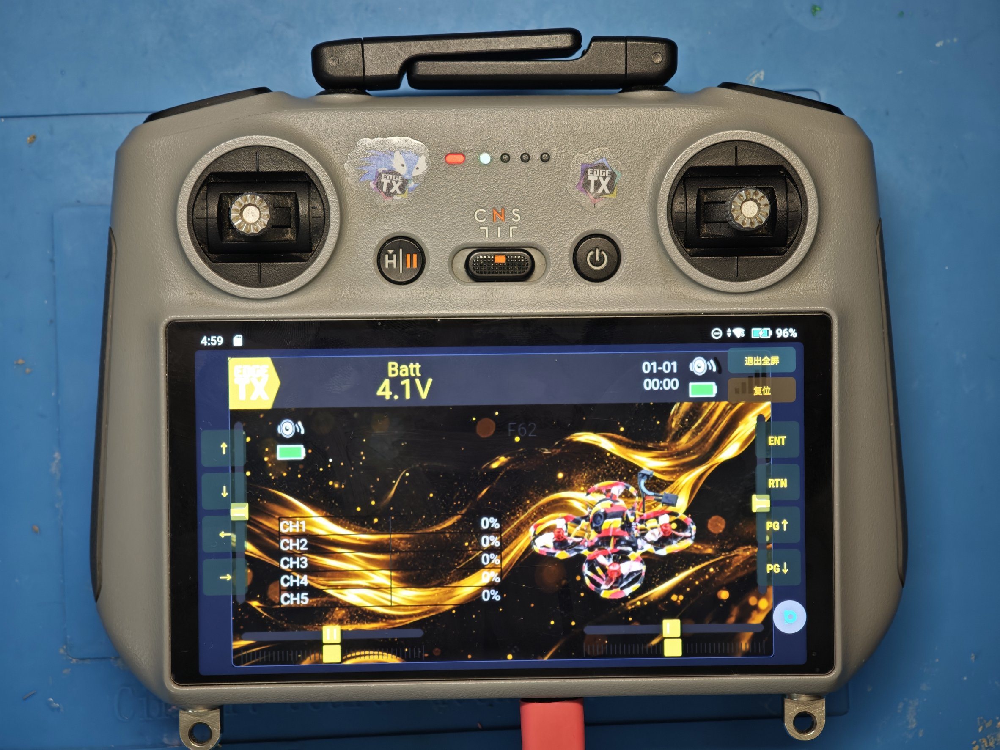
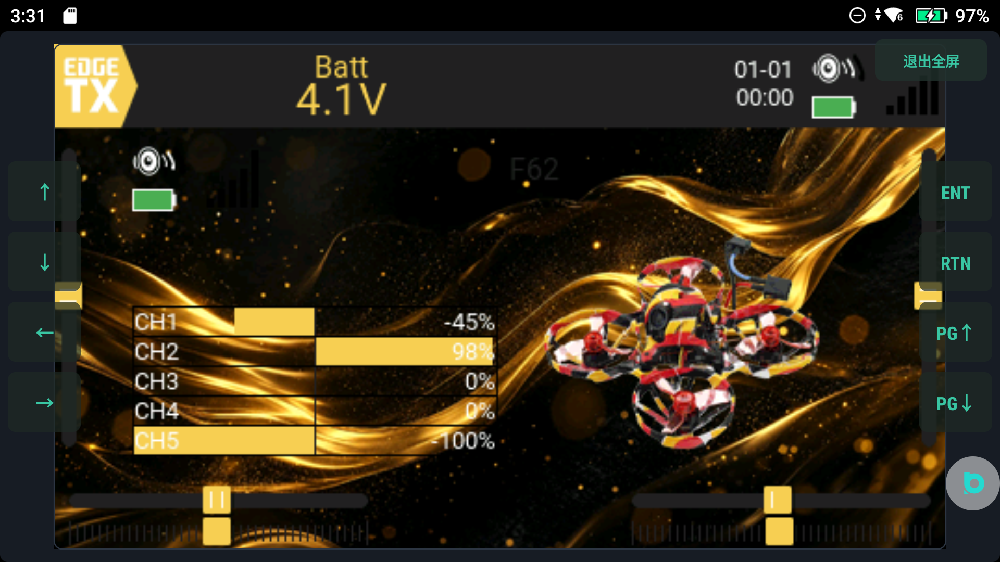
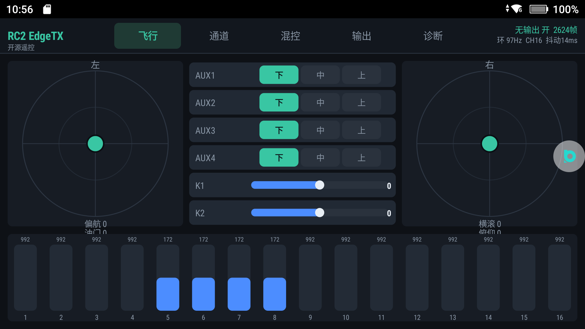
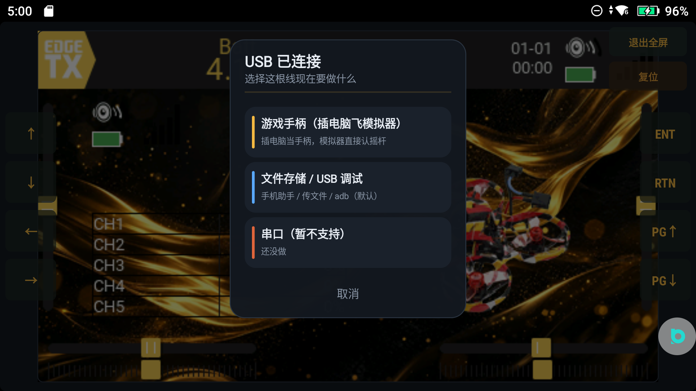
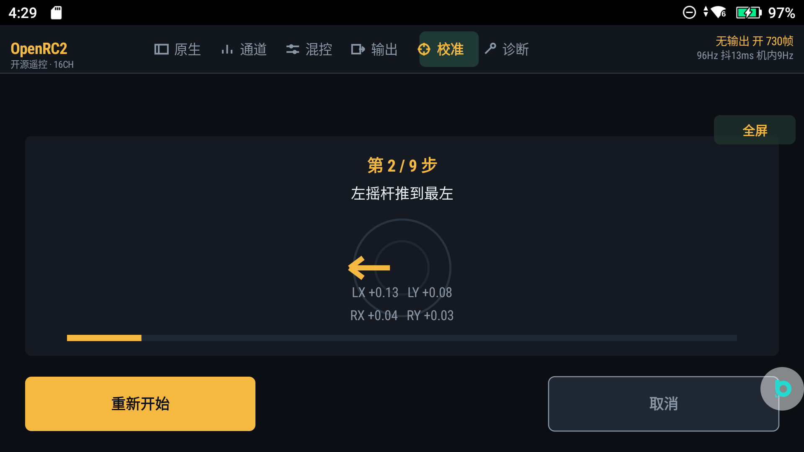
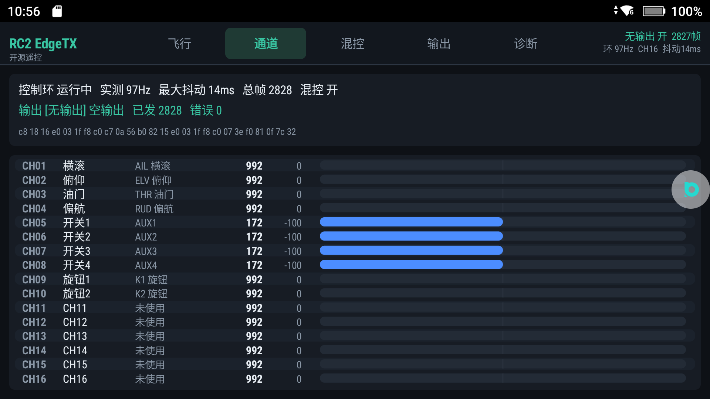

# OpenRC2

把 **EdgeTX 2.12.2 的原生内核**（真 C++ 混控 + LVGL 界面）跑进大疆遥控器的安卓系统里，
原装摇杆、触摸屏、实体按键、旋钮**全部可用**；不用另外带控，开机就是 EdgeTX。



> 真机：DJI RC2（已 root），屏幕上跑的就是这个 App —— 左右八颗屏幕键、「退出全屏 / 复位」两个逃生键都在。

## 支持机型

| 机型 | 系统 | 摇杆来源 | 状态 |
|---|---|---|---|
| DJI RC2（`rc331`） | Android 11 / arm64 | DUML `127.0.0.1:40007` 持续流，约 24Hz | ✅ 主目标机型，全功能 |
| DJI RC Pro（`rm510`） | Android 10 / 骁龙865 | DJI 私有 binder（`protocol` 服务）+ `174` 按键帧 | ⚠️ 摇杆/按键已接，HID 手柄不可用（无 root） |
| 普通手机 / 平板 | arm64 + 32位兼容 | 无物理摇杆，只能用触摸 | ⚠️ 能起核心，需 32 位 ABI 支持 |

## 能做什么

### 1. 原生 EdgeTX 内核，不是皮肤

`libetx.so` 是把 `radio/src` 整套编出来的：混控、曲线、逻辑开关、飞行模式、模型管理、Lua 脚本引擎、
主题系统全部是上游代码，界面渲染走 LVGL 8.2，我们只做「安卓 ↔ 内核」的搬运。



### 2. 原装摇杆直接驱动原版混控

- 摇杆不走 evdev，走大疆私有 TCP（`40007`，DUML 封装，`cmd_set=6 / cmd_id=174` 摇杆帧，6×u16 小端，中点 1024、行程 ±660）；
- 解析后按 `RH,RV,LV,LH,P1,P2,P3` 七轴喂给内核，`0..4096`、中位 `2048`；
- 每 10ms 调一次 `doMixerCalculations()`，所以 EdgeTX 自己的混控真的在跑，不是摆设；
- 断连重连单线程做、快照整体替换防撕裂、中位死区 2% 防漂移。



### 3. 触摸 + 实体键 + 旋钮

点击可聚焦控件、按钮类可直接点；方向键/ENT/RTN/PG↑/PG↓ 映射到 EdgeTX 菜单导航；
旋钮一格 = 改值 1%。列表滚动走 LVGL 的 `act_obj`，不会滚错层。

### 4. USB HID 游戏手柄（需一次性 root 授权）

把遥控器变成标准 USB 手柄（4 轴 + 按键），插电脑后模拟器直接认，不用装驱动。
发包跑独立 4ms 线程（约 250Hz），比塞在控制环里稳得多。

> 注意：建 USB gadget 是内核操作，**必须 root**。没 root 的机型（如 RC Pro）这条不可用。



### 5. 自动校准（推哪根认哪根）

开始后先自动取中点，然后你推哪根杆，它就绑哪一根（顺序：油门 → 副翼 → 俯仰 → 偏航），
反向不用手选——min/max 都采，写盘时自然反向；最后 5 秒满行程测试，记录真实行程并留 2% 余量。



### 6. 诊断与一键导出

诊断页可以跑自检、看设备信息、切遥控器型号（自动 / RC2 / RC Pro），
一键导出 `sd_probe.txt`（SD 路径 + `init_rc` + 目录清单）、`hid.txt`、`native.txt` 到 `files/exports/`。



## 安装

1. 下载 `RC2ETX-<版本>.apk`（调试签名，可直接覆盖升级）或 `-release.apk`（正式签名，发给别人用）；
2. **首次运行会自动铺 SD 骨架**：`RADIO/`、`MODELS/`、`SCRIPTS/TOOLS/`、`THEMES/`（含 v15 金色主题）、`IMAGES/`；
3. 只有补缺、不覆盖你改过的配置 —— 想恢复出厂就在设置里清掉 `Android/data/com.rc2.etx/files/sd`。

> 换签名（调试 ↔ 正式）必须先卸载，否则报「应用未安装」。卸载会清掉上面那个 `sd` 目录，先备份。

## 构建

```bash
export NDK=.../android-ndk-r26    # 与 RC2-EdgeTX-Native 相同
ETX_SO=/path/to/libetx.so ./scripts/build-apk.sh 1.23.0
```

- **ABI 只出 `armeabi-v7a`**：RC2 这台 ROM 对新装 App 强制 32 位，带 arm64 反而 `INSTALL_FAILED_INTERNAL_ERROR`；
- 链接参数 `-shared -fPIC -static-libstdc++ -llog -Wl,-soname,libetx.so`；
- 构建脚本默认用 `keep/libetx.so` 基线，换 so 必须显式 `ETX_SO=`，并对基线做未定义符号比对。

## EdgeTX 侧改动（vendor 3 处）

| 文件 | 改动 | 原因 |
|---|---|---|
| `radio/src/targets/horus/hal.h` | 加 `#if defined(RC2V15)` + `ADC_DIRECTION {1,1,1,1,1,1,1}` | 让 v15 板级 ADC 方向与 RC2 的摇杆序一致 |
| `libui/table.cpp` | `setRowCount` / `select` 首行 `if (!lvobj) return;` | `Window::deleteLater()` 是同步的，退出菜单时 table 可能已析构 |
| `libui/menu.cpp` | `addLine` 判 `if (update && lvobj)`、`updateLines` 首行空检查 | 同上，真正炸的是 `updateLines()` 里的 `lv_table_set_cell_value` |

## RC Pro 专章

- 摇杆锁在 DJI 私有服务里：`ServiceManager.getService("protocol")` → `transact(4)` 发 `cmdSet=6/cmdId=4`，
  回调按小端解 6×uint16（`右水平/右竖直/左竖直/左水平/左波轮/右波轮`）；
- **白名单按进程名匹配**，采集代码必须跑在 `android:process="com.dpad.fuli"`；
- 按键/挡位走 `40007` **快照模式**（连一次给一帧就断），`06/174` 帧 17 字节载荷：五维、C1–C3、挡位、快门、返航；
- 没有 root，所以 USB HID 手柄不可用。

## 已知限制

| 项 | 说明 |
|---|---|
| 机身射频发 ELRS | 不可行：DJI 私有 SDR + 定制 ASIC，没有公开接口 |
| 接收机改发射 | 不可行：TX/RX 固件 target 与 PA/LNA 引脚表不同 |
| 脚本页入口 | QuickMenu 第 9 个磁贴（`APP/LUA脚本`）未创建，待查 gate 条件 |
| 模型格空白 | `modelslist` 被 `loadYaml()` 清空后未装回，排查中 |
| 64 位 | 需另编 aarch64 `libetx.so` 并适配 HAL，属独立排期 |

## 合规与声明

- 本项目把 EdgeTX（**GPLv2**）编进 APK，因此**整个 App 以 GPLv2 发布**，源码见本仓库；
- 与 DJI 无任何关联，不包含大疆的任何代码或签名；改机、root、刷机风险自负；
- 无线电发射须遵守所在国家/地区的法规与执照要求；
- 无任何担保，按「现状」提供。作者：**软糖布丁**。

## 下载

- GitHub Releases：<https://github.com/456erddgr/OpenRC2/releases>
- 国内镜像（123 云盘）：<https://1843626542.share.123pan.cn/123pan/VX07Td-v8SoA?pwd=nRmH>　提取码 `nRmH`

## 路线图

- [x] 原生内核移植 / 摇杆 / 触摸 / 按键 / 旋钮
- [x] USB HID 手柄（250Hz）
- [x] 自动校准 / 诊断导出 / 型号设置
- [x] RC Pro binder 摇杆 + 174 按键
- [ ] 可视化设置页（型号/主题/校准/导出 四张卡片）
- [ ] 脚本页入口、模型格空白
- [ ] aarch64 构建

## 校准（v2，1.25.x 起）

校准页为**独立重写实现**（`app/src/com/rc2/etx/ui/CalibPage.java`），不再沿用旧 `CalibPanel`。

流程：

1. **采中点（0.9 s）**：静置，记录 10 根轴基准；
2. **认轴**：推一下哪根杆就自动绑定哪根（油门→副翼→俯仰→偏航），不需要手动选反向；
3. **转圈采满**：两根摇杆各转几圈，逐轴记录**实测峰值**，每根轴累计 ≥2 次 ≥0.90 即通过；
4. **回中（1.5 s）**：四根全部回中并保持，取**该窗口平均值**作为最终中点；
5. **落盘并同步**：`calib.min/max` 用实测峰值（下限 0.55 防止饱和成 ±100%），
   写 `Store.saveCalib` → `radio.save()`；同时 `DumlStick.shrinkSpan()` 把原始行程按峰值缩小，
   `input.reset()` 让 EdgeTX 立刻生效。

关键设计：**100% 由你实际推到的位置决定**，而不是写死 ±1.0。这样 RC Pro 这类行程偏小的机器推到底也能显示 100%。

## 已知问题：RC2 摇杆数据链路约每 6 秒被 `dji_link` 重置

现象：`connected → 收 2 帧 → Connection reset`，约 6 秒一次；界面上表现为“拨一会儿卡一下”。

已排除：

- **不是大疆模拟器抢连接**：`ps`/`ss` 确认当时只有 `com.rc2.etx` 一个客户端；
- **不是心跳缺失**：抓包（`re/now.pcap` 312 帧、`re/long.pcap` 1557 帧）证明**服务端从不发心跳**，
  只有客户端每 ~30 ms 主动发 `01 01 08 0a | u32 t | u32 t`；我们已按此实现，
  但 A/B 测试显示“发 / 不发心跳都会 6 秒断”；
- **不是时钟域**：`t` 改成 `SystemClock.elapsedRealtime()`（与服务端同域）后行为不变。

当前最强线索：服务端 socket 的 `Recv-Q` 持续堆积（实测 84 字节 = 7 帧心跳未读），
`dji_link` **不消费**我们发出的任何字节就 RST —— 说明这条 40007 连接在它看来只是
“已订阅的数据通道”，而**订阅/注册**动作发生在我们尚未定位的另一条连接或 Binder 上。

影响面：只影响手感连贯性（`StickSmooth` 有断线桥接，不会乱跳），不影响通道数值正确性。

## 蓝牙 HID 手柄：本机不可行（结论）

`dumpsys bluetooth_manager` 的 profile 列表只有 `HidHostService`（收），**没有 `HidDeviceService`（发）**；
`pm list features` 也没有 hid 相关特性。因此 `BluetoothHidDevice.registerApp()` 无法注册，
装 priv-app 授 `BLUETOOTH_PRIVILEGED` 同样无效 —— 需要替换系统蓝牙栈（BlueZ/Bumble 走 HCI 直通），不在本项目范围。

USB HID 手柄（`/dev/hidg0`）不受影响，仍是模拟器首选方案。

### 断连实测（1.26.7，24 秒窗口）

```
$ adb logcat -d | grep ETX-Duml | grep -c connected      → 5
$ adb logcat -d | grep ETX-Duml | grep -cE "EOF|reset"   → 4
11-02 02:34:07.485  W ETX-Duml: link down: SocketException: Connection reset
11-02 02:34:07.498  I ETX-Duml: connected 127.0.0.1:40007
```

结论：稳定复现 **~6 秒一次 RST**，客户端 **13 ms** 内重连成功。
由于每次重连都能立刻收到摇杆帧，数据本身没丢，影响集中在“帧率在 6 秒边界上掉一帧”，
`StickSmooth` 的断线桥接（`gap > 250ms` 时从新位置起步）负责不产生跳变。

### 开机落在哪一页

冷启动默认进「原生」页（EdgeTX 实时画面）+ 顶部七页签；
App 已在运行时再 `am start` 只走 `onNewIntent`，**不会重置当前页签**——
所以用 adb 钩子连续操作时会停在你上次停留的页，这是设计行为，不是 bug。

### 3~6 秒 RST 的缓解（1.27.0）：TCP + Binder 双源

RC2 上同样存在大疆的 `com.dji.protocol.IProtocolManager`（`service list | grep protocol` 可见）。
本版把摇杆做成**双源**：

- 正常情况下 `127.0.0.1:40007` 的 TCP 帧优先（约 9 Hz，延迟最低）；
- 一旦 TCP 超过 **220 ms** 没有新帧（`dji_link` 每次 RST 的空档），立刻用 binder 通道
  （`transact(4)` → `IPackListener` 回调，实测 6 通道、中位 1024、约 6 Hz）补上。

实测日志：

```
I ETX-Radio: binder 补帧 #2
I ETX-Radio: binder 补帧 #3
```

意义：RST 仍然存在（协议层还没攻下），但**用户侧不再感到“卡住不动”**——空档由 binder 填满。
