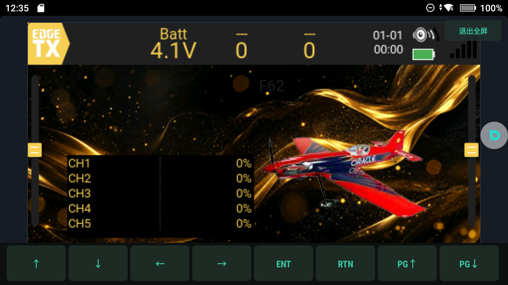
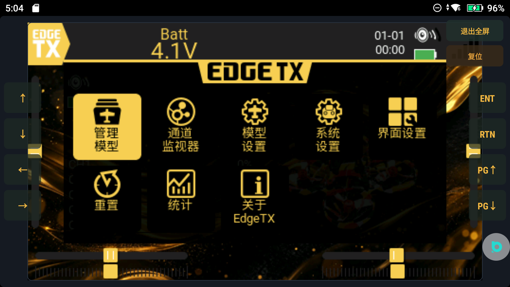
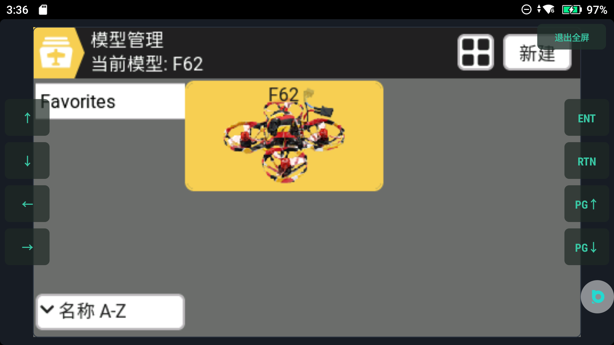
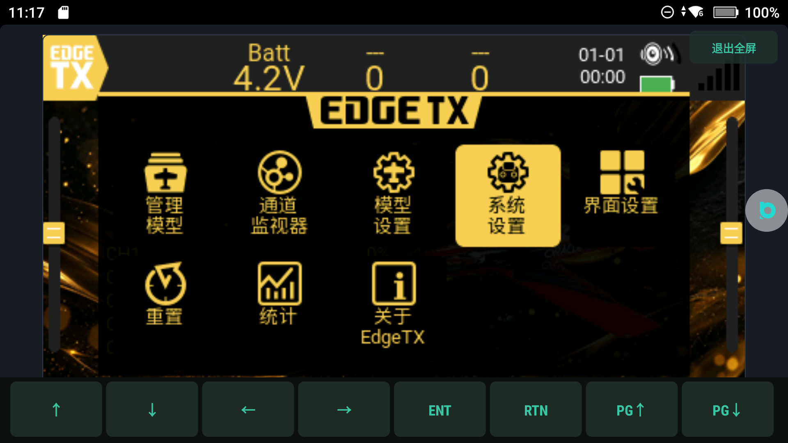
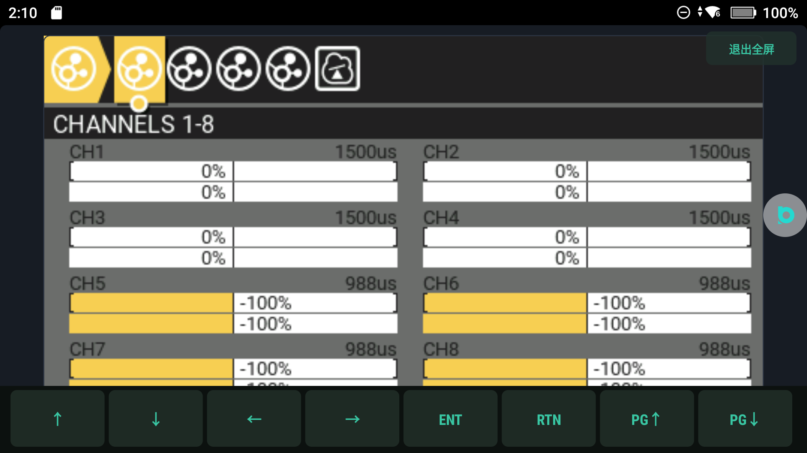

# OpenRC2 — 在 DJI RC2 上跑真正的 EdgeTX

> 作者：**软糖布丁**
> 一台大疆 RC2 遥控器（Android 11 / arm64，已 root 并解 BL），把开源遥控器系统 **EdgeTX 2.12.2** 的原生内核整体移植进一个 Android App，用机身原装摇杆、原装按键、触摸屏直接操作。

这不是"仿 EdgeTX 界面"的壳子。`libetx.so` 是把 EdgeTX 的 `radio/src` 交叉编译出来的**原版内核**：混控、通道、模型管理、校诊、主题、Lua 全是上游代码，我们只写了板级 HAL 和一层 JNI 桥。


_真机：DJI RC2（已 root），屏幕上跑的就是这个 App —— 左侧状态栏、EdgeTX 原生主屏、左右八颗屏幕键、「退出全屏 / 复位」两个逃生键。_



---

## 下载（国内镜像）

> GitHub 在国内经常很慢，APK 与截图包同时放了 **123 云盘**镜像：
>
> **<https://1843626542.share.123pan.cn/123pan/VX07Td-v8SoA?pwd=nRmH>**
>
> 提取码：`nRmH`（链接里已带，点开即取）
>
> 镜像里的内容与 GitHub Release 一致；如果链接失效，请在本仓库提 Issue。

---

## 目录

- [它能做什么](#它能做什么)
- [截图](#截图)
- [它是怎么跑起来的](#它是怎么跑起来的)
- [安装](#安装)
- [USB 游戏手柄（电脑模拟器）](#usb-游戏手柄电脑模拟器)
- [构建](#构建)
- [已知限制](#已知限制)
- [许可证与声明](NOTICE.md)

---

## 它能做什么

### 1. 原生 EdgeTX 内核，不是模拟

- EdgeTX **v2.12.2**（上游 HEAD `3673c518`），板级 target 新增 `RC2V15`，只改了 `radio/src/targets/horus/hal.h` 一处。
- 走的是 EdgeTX 自己的 **LVGL 界面 + 混控引擎**：模型设置里改混控，通道立刻变；CH1–CH16 全部由上游代码算，Java 侧只喂输入、取输出。
- 界面语言中文（上游 CN 变体），主题、字体、图标全部是 EdgeTX 原版资产。

### 2. 原装摇杆真的驱动通道

摇杆**不走 Android evdev**——大疆把它锁在私有服务里：

```
dji_link (127.0.0.1:40007) → DUML 帧 55 CC 30 75
                           → cmd_set 0x06 / cmd_id 0xAE（30 字节）
                           → [16..27] = 6 × u16le
```

- 中点 `1024`，满行程 `364..1684`（±660），约 9.3 Hz，CRC8(0x77) + CRC16(0x3692)。
- 我们做了单飞连接、整帧快照（防撕裂）、断线重连只在 socket 层、中位死区 2%、去外推（消抽搐）。
- 轴序锁死：`lx=RUD  ly=THR  rx=AIL  ry=ELE`，喂内核用 7 轴 MCU 序（`RH,RV,LV,LH,P1,P2,P3`，0..4096 / 中位 2048）。
- **关键**：内核每 10 ms 要 `doMixerCalculations()`，否则 EdgeTX 自己的混控不跑，界面永远 0%。

### 3. 触摸 + 按键 + 旋钮

- 触摸语义按遥控器习惯做：点行=聚焦，进入/改值用 `ENT`/方向键/旋钮（旋钮一格 1%），按钮类控件支持直接点。
- 左右各四颗屏幕按键：`↑ ↓ ← → / ENT RTN / PG↑ PG↓`。
- 主题里可换界面配色，`v15` 主题是这套机器上最好看的。

### 4. USB 游戏手柄（插电脑飞模拟器）

- 选「游戏手柄」后，RC2 变成一个标准 HID Joystick：4 轴 + 8 键 + Hat。
- 四轴顺序 `X=AIL  Y=ELE  Z=THR  Rz=RUD`，报告 10 字节（4×u16 + buttons + hat）。
- Windows / Linux / macOS 都免驱，模拟器（RealFlight、Liftoff、DRL、PhoenixRC…）直接认。

### 5. 校准向导

四摇杆逐个推到底，自动记录行程与中点；也能逐通道绑源、反向、恢复默认。

### 6. 诊断

帧率、抖动、通道值、CRSF 编码自检、设备信息、root 状态，全部在一页。

---

## 截图

| 飞行页 | 通道监视 | 原版 EdgeTX 主屏 |
|---|---|---|
|  |  |  |

| EdgeTX 菜单 | 模型管理 | 中文菜单 |
|---|---|---|
|  |  |  |

| 校准向导 | USB 选择弹窗 | 通道监视器（内核） |
|---|---|---|
|  |  |  |

<p align="center"></p>

---

## 它是怎么跑起来的

```
┌───────────────────────────── App 进程（arm）─────────────────────────────┐
│  MainActivity                                                            │
│   ├─ RadioView / NativePanel     自绘 UI：摇杆、通道条、按键、弹窗        │
│   ├─ Radio（单例）               DUML 摇杆线程 + 混控 + 统计              │
│   │   ├─ DumlStick               127.0.0.1:40007 拉摇杆帧                │
│   │   └─ HidJoystick             /dev/hidg0 写 HID 报文（USB 手柄）      │
│   └─ EtxNative (JNI) ────────────┐                                       │
└──────────────────────────────────┼───────────────────────────────────────┘
                                   │ 17 个 JNI 符号（裸名 T Java_*）
┌──────────────────────────────────▼───────────────────────────────────────┐
│  libetx.so —— EdgeTX 2.12.2 原版内核                                     │
│   lvgl 界面 · 混控引擎 · 模型存储(YAML) · 主题 · 校诊 · Lua 5.3           │
│   板级 target: RC2V15（HAL 里只有 LCD 尺寸 / ADC 方向 / RTC 桩）         │
└──────────────────────────────────────────────────────────────────────────┘
```

关键设计取舍：

- **不重写业务**：混控、通道、模型都在 so 里，Java 只做 IO 与呈现。这样才能"改混控立刻生效"。
- **一帧一纹理**：内核渲染到 `uint16` 帧缓冲，JNI 转 ARGB 后整帧贴图；脏标记 + 真实 elapsed 才把 CPU 从 15% 降到 4%。
- **按键走内核**：`-DHARDWARE_KEYS` 打开后，方向键/ENT/RTN/PG 都是 EdgeTX 自己的事件，不模拟。
- **arm 32 位**：这台 ROM 对新装 App 强制 32 位（只带 arm64 会 `Error deriving application ABI`），所以 so 只出 `armeabi-v7a`。

---

## 安装

**前置**：DJI RC2（product `rc331`），已 root、已解 BL，adb 可用。

```bash
adb install -r RC2ETX-<ver>.apk
```

APK 下载：GitHub Release，或国内镜像 **<https://1843626542.share.123pan.cn/123pan/VX07Td-v8SoA?pwd=nRmH>**（提取码 `nRmH`）。

- Manifest 固定在 `minSdk 29 / targetSdk 29`：targetSdk ≥ 30 会被 DJI 的 `ReviewPermissionsActivity` 劫持。
- 首次启动会申请 SD 卡目录；模型/配置写在 `Android/data/com.rc2.etx/files/sd/`，和 V15 出厂卡同构。
- 改过 `sd/` 下文件后记得 `chown 10038:10038`，否则 App 静默写不进。

---

## USB 游戏手柄（电脑模拟器）

建 HID gadget 需要 root（Android 没有公开接口），所以做成"一次性 + 之后免 root"：

1. 用 USB 线把 RC2 连电脑，确认 `adb devices` 能看到。
2. 双击 `pc\RC2-USB手柄-开启.bat`（本 ROM 的 `su` 在 `/debug_ramdisk/su`，脚本已按这个写，并会回退试 `su`）。
3. 成功标志：脚本打印 `state=configured`，Windows「设备和打印机」出现 `HID-compliant game controller`。
4. 之后每次插线，在 App 弹窗里选「游戏手柄」即可，**不必再 root**。
5. 想恢复传文件/调试：`pc\RC2-USB手柄-还原.bat`，或弹窗里选「文件存储 / USB 调试」。

> 注意：绑 HID gadget 会顶掉 USB adb。调试期间请用无线 adb（`adb connect <ip>:5555`）。

---

## 构建

```bash
# 1) 编内核（需要 NDK + EdgeTX 源码，见 RC2-EdgeTX-Native/）
cd RC2-EdgeTX-Native && ./scripts/build-all.sh

# 2) 打 APK
cd ../RC2-EdgeTX
ETX_SO=../RC2-EdgeTX-Native/out/libetx/libetx.so ./scripts/build-apk.sh 1.20.7
```

`scripts/build-apk.sh` 会：aapt2 编资源 → javac → 注入 `.so`（ZIP_STORED）→ `zipalign -p 4` → `apksigner --min-sdk-version 29`，并在注入前做**未定义符号门禁**（只放行 libc/liblog 白名单），防止把坏 so 打进包。

默认不会覆盖 `app/jniLibs/`（踩过两次坑：自动拷贝把 `Multi_Buffer` / `tanhf` 这类符号带进来直接 dlopen 崩）。

---

## 已知限制

诚实列清楚，别指望它现在全绿：

| 项 | 状态 |
|---|---|
| 「模型管理」网格不显示模型格 | **已知问题**：`modelslist` 数据正常（`labels.yml` 有条目）、`DE65.png` 在、`当前模型: F62` 正常，但格子不画。疑在 tile 渲染/布局，追查中 |
| EdgeTX 菜单里按 `ENT` 偶发崩溃 | **修中**：上游 `menu.cpp` 先 `deleteLater()` 再 `onPress()` 的 UAF，已在 `table.cpp::setRowCount()` 加空指针检查（vendor 第 2 处改动） |
| Lua 脚本页（APP/LUA脚本） | 引擎已编进去（Lua 5.3，621 个符号），但要等上面那条修完才能真正用起来验 |
| 机身射频发 ELRS | **不可行**：DJI 私有 SDR + 定制 ASIC，没有公开接口。正路是外接 ELRS TX 模块 |
| 接收机改发射 | **不可行**：TX/RX 固件 target 的 PA/LNA 引脚表完全不同（LR1121 vs SX128X） |
| USB 线四芯焊 TX/RX | **电气错误**：D+/D− 是差分对，不是 UART |
| RTC | 桩，显示 1970/1/01；不影响功能 |
| 菜单行触摸 | 只聚焦，不激活（上游触摸语义如此） |
| 触摸注入 | 这 ROM 封了内核事件注入，`adb shell input tap` 无效，调试走 App 内 adb 钩子 |

---

## 致谢

- [EdgeTX](https://edgetx.org) —— 全部遥控器逻辑与界面（GPLv2）
- [LVGL](https://lvgl.io) —— 图形库（MIT）
- [Lua](https://lua.org) —— 脚本引擎（MIT）
- [ExpressRSS/ExpressLRS](https://expresslrs.org) —— ELRS 协议与脚本（GPLv3，脚本原样随卡分发）

## 许可证

本项目按 **GPLv2** 发布（因为链接了 EdgeTX）。完整声明、第三方清单、以及"我不是大疆"的说明见 [NOTICE.md](NOTICE.md)。
