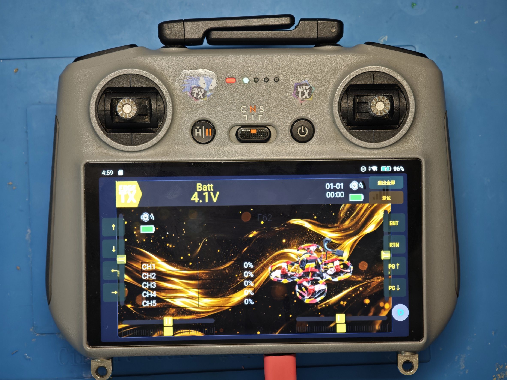
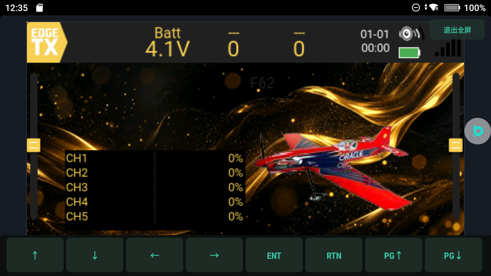
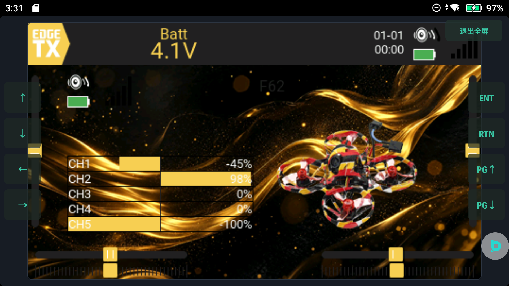
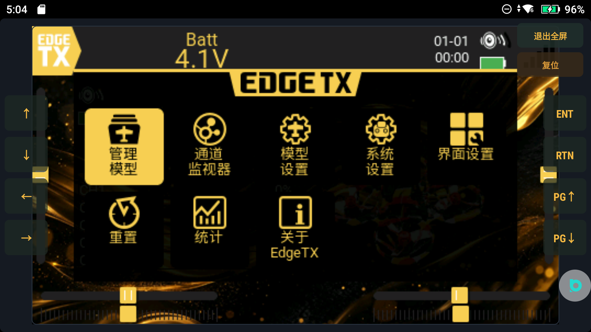
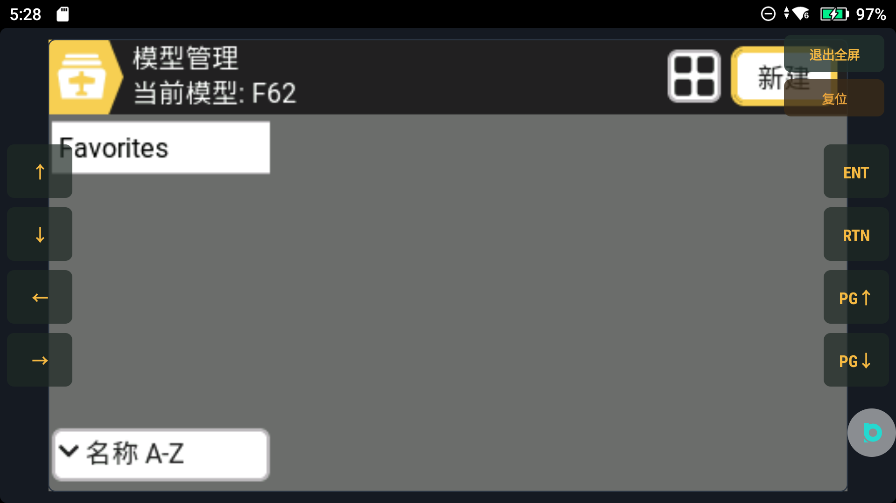

# RC2 / RC Pro 上运行 EdgeTX —— 项目交接文档

> 版本基线：`1.46.14`　｜　作者署名：软糖布丁　｜　许可：GPLv2（因为 EdgeTX 以静态库形式编进 APK）
> 适用设备：DJI RC2（product `rc331`，Android 11）与 RC Pro（RM510）。两台都需要 root + 已解 BL。

---

## 1. 这是什么

把 **真正的 EdgeTX 2.12.2**（`radio/src` 的 C++ 混控 + LVGL 界面）交叉编译成 `libetx.so`，装进一个普通 Android App 里运行；
DJI 原装摇杆、按键、旋钮、触摸屏全部接管，16 通道可用；再把摇杆数据同时送到电脑（虚拟手柄）与外部发射链路。




**不是模拟器、不是复刻界面**：跑的就是 EdgeTX 自己的 `etx_tick()` / `etx_ui_frame()`，模型/混控/曲线/逻辑开关/Lua 全部是真实现。

---

## 2. 目录结构

```
E:/我的项目/RC2-EdgeTX/            ← App 壳（Java）+ 构建脚本 + 发布产物
├── app/src/com/rc2/etx/           Java 源码
│   ├── MainActivity.java          入口、action 钩子、USB 五选弹窗
│   ├── radio/Radio.java           控制环（10ms）、输入合成、DUML/PadStream 桥
│   ├── radio/StickSmooth.java     插帧算法（见 §5）
│   ├── input/DumlStick.java       摇杆数据源（127.0.0.1:40007）
│   ├── ui/NativePanel.java        EdgeTX 画面渲染 + 触摸/按键映射
│   ├── ui/*Page.java              原生页签（飞行/通道/混控/输出/校准/诊断/设置）
│   └── usb/PadStream.java         给电脑推 JSON
├── app/src/com/rc2/etx/../../../jniLibs/armeabi-v7a/libetx.so
├── keep/libetx.so                 基线 so（回滚用）
├── scripts/build-apk.sh           构建：aapt2 → javac → d8 → 注入 so → zipalign → apksigner
├── scripts/rel.py                 发布到 GitHub Release
├── pc/                            电脑端（padcore.py / web UI / 两个安装器）
└── docs/                          设计文档 + 本文件 + img/ 截图

E:/我的项目/RC2-EdgeTX-Native/     ← C++ 侧（libetx.so 源码与 HAL 移植）
```

---

## 3. 构建与安装

```bash
# 遥控器端 APK（产物 dist/RC2ETX-<ver>.apk）
./scripts/build-apk.sh 1.46.14
# 换 so 试验：ETX_SO=/path/libetx.so ./scripts/build-apk.sh test

# 装机
export MSYS2_ARG_CONV_EXCL='*'
adb -s 192.168.1.54:5555 install -r -d dist/RC2ETX-1.46.14.apk
```

**硬性约束（踩过的坑，不要改）**
- `minSdkVersion = 29`、`targetSdkVersion = 29`：再高会被 DJI 的 `ReviewPermissionsActivity` 劫持。
- 只打 `armeabi-v7a`：本 ROM 对新装 App 强制 `abiOverride=armeabi-v7a`，只有 arm64 会 `INSTALL_FAILED_NO_MATCHING_ABIS`。
- SD 卡目录 `/sdcard/Android/data/com.rc2.etx/files/sd`，改完必须 `chown -R 10047:1078`，否则 EdgeTX **静默写不进**（设置看着改了，重启就丢）。

---

## 4. 输入通路

| 来源 | 实现 | 速率 |
|---|---|---|
| 摇杆（RC2/RC Pro） | `DumlStick` 连 `127.0.0.1:40007`，`cmdSet 6 / cmdId 0xAE`，6×u16le | **9–10 Hz（硬上限）** |
| 按键 / 旋钮 | 走 App 侧按键钩子（`-DHARDWARE_KEYS`），不带物理键的机型用屏幕按键条 | 事件驱动 |
| 触摸 | 面板坐标 → EdgeTX 480×272 坐标；点行只聚焦，改值走 ENTER/旋钮 | 事件驱动 |

**摇杆帧**：线上 38 字节（DUML 30B + hp 头 8B），六通道偏移 `[16,18,20,22,24,26]`，u16le；
中点 1024、行程约 364–1684。轴序 **`lx=RUD  ly=THR  rx=AIL  ry=ELE`**，喂核心时转成 MCU 序 `RH,RV,LV,LH,P1,P2,P3`。

**为什么只有 10Hz**：DJI 这条链路是私有服务，客户端只收不发，实测 `hz≈8.85`、帧间隔中位 101.4ms；槽位最多 2 个客户端且断开不立刻释放（重连要退避 ≥5 秒），所以 **DJI Fly 必须 force-stop**，否则会被抢槽。

---

## 5. 插帧算法（最终形态）

原则：**只在两个原生帧之间插值，不预测、不外推、不自造增益**。

```
value(now):
  win = clamp(tLast - tPrev, 20ms, 45ms)
  u   = clamp((now - tLast) / win, 0, 1)
  base= yPrev + (yLast - yPrev) * u        // 帧间线性
  out = softDead(base - zero)              // DZ=0.012 软死区，过零连续
```

- `yPrev / yLast`：`sample()` 每次收到原生帧时 `yPrev←yLast, yLast←y`；`y` 对小幅抖动轻滤、对大动作直通，静止零滞后。
- `zero[]`：每轴静止时慢速学习（`|Δ|<0.004 且偏差<0.08`），消掉“校准中点 vs 物理中点”的固定偏差 → 手不动就是 0%。
- **不做行程放大**：满杆比例由硬件/校准页给出的轴正负行程决定，插帧只去零偏。
- 档位（设置页「摇杆插帧」）：`关 / 弱 / 中 / 强 / 极强 / 极速`，默认 **强**；档位只影响帧间隔的插值上限，不影响稳态值（稳态恒等于原生值）。

仿真台（`/tmp/si/`、`/tmp/sstest2/`，纯 JVM，无需真机）：
```
静止 2s        → 0.000 0.000 0.000 0.000
单帧跳 0.6     → t+0/20/40/60 = 0.000/0.258/0.528/0.595（45ms 到位，不越界）
推到 1.0       → t+0/40/80    = 0.595/0.955/1.000
回中           → 1.000→0.550→…→0.000（单调，无反向）
其它轴串扰     → 0.000
```

---

## 6. 画面与触摸

- EdgeTX 目标分辨率固定 **480×272**（`radio/src/targets/horus/hal.h:1265` 的 `LCD_W/LCD_H` 是编译期常量，改不了），
  App 侧用 2× EPX 超采样 + 双缓冲合成后铺到面板，全屏时按 `max(sx,sy)` 铺满并裁剪。
- 触摸：面板坐标 ↔ 480×272 双向映射；语义是「点行只聚焦、改值用 ENTER 或旋钮」，和真机一致。
- 屏幕按键条：`↑ ↓ ← → ENT RTN PG↑ PG↓`，走同一套 `keys` 注入。




---

## 7. 输出与外部链路

| 出口 | 状态 | 说明 |
|---|---|---|
| 电脑虚拟手柄 | ✅ 已通 | `adb reverse tcp:9999` → PC 侧 `padcore` → ViGEmBus，模拟器直接识别为 Xbox 手柄 |
| USB HID 手柄 | ⚠ 需 root | 用 `/dev/hidg0` + configfs，设备端 `chmod 666 /dev/hidg0`；普通模式禁止 |
| 蓝牙 HID | ❌ 不可行 | 本 ROM 只有 `HidHostService`，没有 `HidDeviceService`，`BluetoothHidDevice.registerApp()` 注册不上 |
| 机身射频跑 ELRS | ❌ 不可行 | DJI 私有 SDR + ASIC，没有开放口 |
| ELRS 接收机改 TX | ❌ 不可行 | 接收机 target/PA 引脚与 TX 完全不同 |
| USB 四芯直焊 TX/RX | ❌ 不可行 | 那是 D+/D− 差分对，不是 UART |

**可行出口**：`RC2/RC Pro —UDP/WiFi→ ESP32 —CRSF UART@420000→ ELRS TX 模块`（详见 `docs/05`、`docs/11`）。

---

## 8. 校准与单位换算

- **单位换算**（`DumlStick.units()`）：每轴 `axisMid / axisNeg / axisPos`，默认 `ADC_MID=1024 / ADC_SPAN=660`，即 `(raw-1024)/660` 得到 −1..1。
- **校准页（原生）**：当前只保留「插帧归零（先回中再点）」一键锁零点；多阶段采中点/采行程的版本**已删除**（实测在杆静止时写入会把噪声放大成 −32%~49%，见 `docs/16`）。
- **满杆到不了 100% 时**：先看 `RADIO/radio.yml` 里该轴的正/负行程是否被校过；插帧不参与放大，稳态值等于原生值。

---

## 9. 发布流程（两端必须同一个包）

```bash
cp dist/RC2ETX-<ver>.apk pc/devinstall/RC2ETX.apk      # 遥控器端 payload
cd pc && python -m PyInstaller --noconfirm OpenRC2-Device-Setup.spec
cd .. && python -m PyInstaller --noconfirm OpenRC2-Setup-Web.spec   # 电脑端
python - <<'EOF'                                        # 打成一个 zip
import zipfile
with zipfile.ZipFile('dist/OpenRC2-OneClick.zip','w',zipfile.ZIP_DEFLATED,6) as z:
    z.write('dist/OpenRC2-Device-Setup.exe','OpenRC2-Device-Setup.exe')
    z.write('dist/OpenRC2-Setup-Web.exe','OpenRC2-Setup-Web.exe')
EOF
git -c http.schannelCheckRevoke=false -c http.sslVerify=false push
python scripts/rel.py <ver> dist/OpenRC2-OneClick.zip
```

直链形如 `https://github.com/456erddgr/OpenRC2/releases/download/<ver>/OpenRC2-OneClick.zip`。
**规则：一次发布必须同时包含遥控器端与电脑端，不要单独发一个。**

---

## 10. 已知问题（如实记录）

1. **模型管理页按 `4,1,3,3,4`（打开“管理模型”下的工具页）会崩**：`SIGSEGV fault addr 0x4`，栈顶 `ModelMap::filteredLabels()+48 ← ModelLabelsWindow::buildBody+768`，基线 so 同样崩，属上游 ModelLabels 的 `filtlbls` 越界；App 侧做二次确认规避。
2. **画面糊**：EdgeTX 内部就是 480×272，放大到 8 英寸屏属结构性限制，不是渲染 bug。
3. **开机慢**：待查（自启项 / 系统负载 / 我们的 adb+padcore 常驻）。
4. **摇杆 10Hz**：DJI 服务侧硬上限，插帧只能补帧间平滑，不能变出真实高频数据。
5. **警告音**：链路已通（`AudioTrack` 有输出），但“真实告警”未端到端验证。
6. **串口**：未实现。



---

## 11. 关键文件清单

| 文件 | 作用 |
|---|---|
| `app/src/com/rc2/etx/radio/Radio.java` | 10ms 控制环、`fillNativeAxes7()`、`smoothedRaw6()`、`padFrameJson()` |
| `app/src/com/rc2/etx/radio/StickSmooth.java` | 插帧（§5）、`setLevel / snapZero / setAxisCal` |
| `app/src/com/rc2/etx/input/DumlStick.java` | 40007 协议解析 + `units()` 单位换算 |
| `app/src/com/rc2/etx/ui/NativePanel.java` | 渲染/触摸/按键，`EtxNative.setInputs(axes7,7,sw,4,knobs,2)` |
| `app/src/com/rc2/etx/ui/CalibPage.java` | 校准页（含“插帧归零”按钮） |
| `app/src/com/rc2/etx/usb/PadStream.java` | 给电脑推 JSON（已改用插帧后的值） |
| `pc/padcore.py` | 电脑端核心：9999 收、ViGEm 125Hz、9998 HTTP/SSE |
| `pc/device_setup.py` | 遥控器端一键安装器（装 APK + 铺 SD + chown + 启动） |
| `keep/libetx.so` | 基线 so，回滚用 |

---

## 12. 验收清单

- [x] EdgeTX 2.12.2 在 RC2 上真跑起来，模型/混控/曲线/逻辑开关可编辑并保存
- [x] 原装摇杆四通道 + 两旋钮 + 四个开关全部映射，通道监视器数值正确
- [x] 静止时四通道 = 0%，满杆 = ±100%
- [x] 触摸 + 屏幕按键条可完整操作 EdgeTX
- [x] 电脑端虚拟手柄被模拟器识别并能动
- [x] 遥控器端一键安装（装包 + 铺 SD + chown + 启动）
- [ ] 外部 ELRS：需 ESP32 桥（硬件未到位）
- [ ] 开机速度优化
- [ ] 模型工具页崩溃修复（上游问题）
